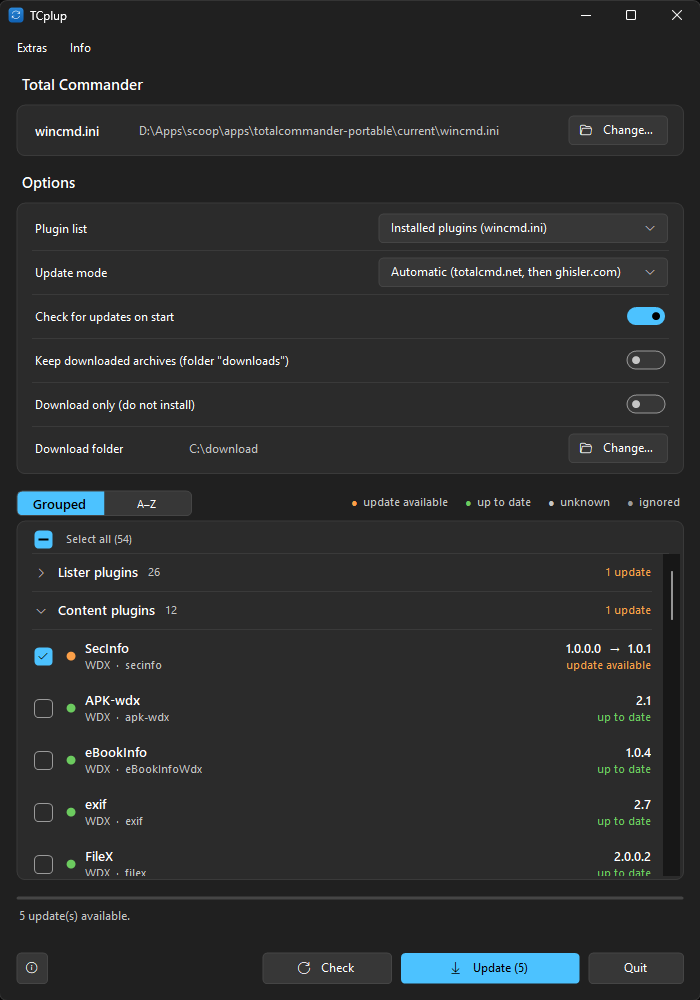

# TCplup

**English** | [Deutsch](README.de.md)

An updater for [Total Commander](https://www.ghisler.com) plugins. It reads the list of your plugins, looks for newer versions on [totalcmd.net](https://totalcmd.net), [ghisler.com](https://www.ghisler.com/plugins.htm) or GitHub, and downloads and installs them – one click for all of them.



## Download

**[Latest release](https://github.com/naderi/tcplup/releases/latest)** – download `TCplup.exe` and run it. No installation needed.

- Or with [Scoop](https://scoop.sh):

  ```powershell
  scoop bucket add naderi https://github.com/naderi/scoop-bucket
  scoop install naderi/tcplup
  ```

**Requirements:** Windows 10 or 11 with .NET Framework 4.5 or later (preinstalled on Windows 10/11), Total Commander 32 or 64 bit (installed or portable).

## How it works

1. **Plugin list.** TCplup finds Total Commander's `wincmd.ini` (environment of a portable installation, running Total Commander, registry, common folders – or choose it with *Change…*). *Plugin list* decides what is checked:
   - **Installed plugins (wincmd.ini)** – the plugins Total Commander has registered (also when the section is moved to another file with `RedirectSection`, as `wincmd_plugins.ini` does).
   - **All plugins in the plugin folder** – every plugin found in the plugin folder, registered or not.
2. **Installed version.** Read from the plugin's file version; if it has none, from `pluginst.inf`, then from the readme of the plugin. After TCplup installs an update it remembers the version, as long as the plugin files stay untouched.
3. **Latest version.** From a source. The *Update mode* decides where plugins without a source of their own are looked up:
   - **Automatic** – [totalcmd.net](https://totalcmd.net) first (`https://totalcmd.net/plugins/<name>`), then the plugin tables of [ghisler.com](https://www.ghisler.com/plugins.htm).
   - **totalcmd.net** or **ghisler.com** – only that one.

   The name is found from the plugin's folder and file names (on totalcmd.net with the site's search as a fallback); a page that clearly belongs to another plugin is ignored. A source can also be set **per plugin** (right-click → *Set source…*): a **GitHub repository** (`owner/repo` or its address – the latest release is used), a totalcmd.net page or ghisler.com. A source set that way always comes first, in every mode. Empty input goes back to automatic.
4. **Update.** The archive is downloaded, its SHA-256 checksum is verified when the source gives one (totalcmd.net, GitHub), and the files are copied into the plugin's folder.

## Using it

| Element | What it does |
|---|---|
| **Plugins** list | Grouped by type: **Lister**, **Content**, **Packer** and **File system** plugins. Click a group header (or press Left/Right or Space on it) to collapse or expand it; the header shows the number of plugins and of updates. **Orange** = update available (ticked by default), **green** = up to date, **grey** = unknown or no source found. Click the box (or press Space) to tick or untick a plugin. Inside a group, plugins with an update come first. Select several plugins with Ctrl and Shift. |
| **Legend** (above the list) | *update available*, *up to date*, *unknown* and *ignored* are filters: click one to show only those plugins, click again to show all. *ignored* is your ignore list. |
| **Check** | Looks for updates again for all plugins. |
| **Update (n)** | Installs the ticked plugins. During the update, *Quit* becomes **Cancel**. |
| **Plugin list** | Installed plugins or all plugins in the plugin folder. |
| **Update mode** | Automatic (totalcmd.net, then ghisler.com), only totalcmd.net or only ghisler.com. |
| **Check for updates on start** | Looks for updates when TCplup starts (it never installs on its own). |
| **Keep downloaded ZIP files** | Keeps the ZIPs in the `downloads` folder next to TCplup. |
| **ⓘ** (bottom left) | About window with version, developer, website and program updates. |

Right-click a plugin (or the selected plugins) for **Update** – installs it right away, also when it is up to date –, *Open source page*, *Open plugin folder*, *Set source…*, *Skip this version* (only this version is hidden) and **Ignore this plugin (never update)**. An ignored plugin stays in the list, dimmed and marked *ignored*; it is not checked, not ticked and not updated until you choose *Stop ignoring this plugin*. **Extras** has *Read plugins again* (F5), *Choose Total Commander configuration…*, *Open plugin folder*, *Select all updates* / *Clear selection* and *Expand all groups* / *Collapse all groups*.

The program appears in German when Windows is set to German, otherwise in English. It follows the light or dark Windows theme and the accent color.

## Good to know

- **Total Commander can keep running.** A plugin that is in use cannot be overwritten, so TCplup renames the old file (`*.tcplup-old`) and puts the new one in its place; the old files are deleted at the next start. Restart Total Commander to load the new versions.
- **Your settings stay.** Existing `.ini` files in the plugin folder are never overwritten.
- **Safe install.** Archives with paths outside the plugin folder are rejected, a failed install is rolled back, and a download whose checksum does not match is not installed.
- **Version numbers are compared, not guessed.** `2.2.3` and `2.23`, or `2.0.0.4` and `2.04`, count as the same version. A page that is older than the installed files is not offered as an update.
- ZIP archives are installed directly (a ZIP that Windows cannot unpack, e.g. with Deflate64, is unpacked with 7-Zip if it is installed). For **7z** and **RAR** archives (some plugins are published that way) TCplup needs [7-Zip](https://www.7-zip.org) (found in `PATH`, in Program Files or in Scoop); without it the plugin shows *7-Zip is needed for this archive*.
- Not every entry on ghisler.com links straight to an archive. TCplup follows links to a GitHub releases page (it then uses the latest release) and to a download page (it takes the first ZIP, 7z or RAR linked there). Names are matched without a trailing "plugin" or "plug", so `sftpplug` finds *SFTP* and `cloudplugin` finds *Cloud*.
- Plugins without a source show *no source found*. A plugin that was not found is searched again after 7 days, or at once when its name shows up in the newest-plugins list of totalcmd.net. Plugins that live on GitHub (or another site) can be given their source by hand. GitHub allows 60 requests per hour without a login, which is plenty for a few plugins.

## Program updates

TCplup updates itself from its GitHub releases: once a day (switch it off in the about window) and on demand; an orange dot on the ⓘ button shows that an update exists. The download is installed only if its signature verifies. With Scoop, TCplup only points to `scoop update tcplup`.

## License

Freeware – free to use, but **not for sale**. See [LICENSE](LICENSE).

## Support

If TCplup saves you time, you can support its development on Ko‑fi. ☕

<a href='https://ko-fi.com/N7N123QIX0' target='_blank'></a>

---

© 2026 [Ali Naderi](https://github.com/naderi) · [digitalent.dev](https://digitalent.dev/en/)
